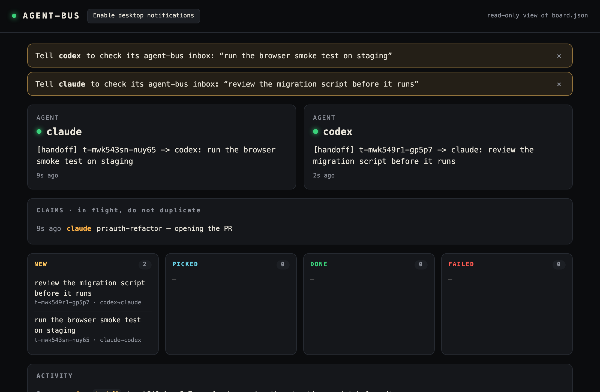

# agent-bus

[中文](README.zh-CN.md)

A shared blackboard for AI coding agents that run on the same machine. Claude Code,
Codex, or any other MCP client connect to it and can then:

- **claim** a topic before acting on it, so two agents never send the same email or open the same PR;
- **hand off** a task to another agent and track it to done or failed;
- **post** a one-line status the other agents and you can read.

It is one Node file with no dependencies. State is one JSON file you can open and read.



## Why

Two agents working for the same person cannot see each other's sessions. Give both the
same request and they both do it. This started after two agents each drafted a reply to
the same email. The fix is small: before any outward action, take a lock that the other
agent can see.

## Install

Needs Node 18 or later.

```bash
git clone https://github.com/SLYysl/agent-bus.git
cd agent-bus
node test.js          # should end with ALL TESTS PASS
```

Connect each agent to the same `server.js`. Use the absolute path.

**Claude Code**

```bash
claude mcp add --scope user agent-bus -- node /absolute/path/to/agent-bus/server.js
```

**Codex** — add to `~/.codex/config.toml`:

```toml
[mcp_servers.agent-bus]
command = "node"
args = ["/absolute/path/to/agent-bus/server.js"]
```

Any other MCP client: run `node server.js` over stdio.

All agents must point at the same board file. By default that is `board.json` next to
`server.js`; set `AGENT_BUS_FILE` to put it elsewhere.

Then give the agents the rules:

- copy [`AGENTS.md`](AGENTS.md) into each agent's instruction file and edit the names, or
- for Claude Code, copy [`skills/agent-bus`](skills/agent-bus) into `~/.claude/skills/`.

## Try it

In one agent:

> Use agent-bus: claim the topic `demo:hello` as claude.

In the other:

> Use agent-bus: claim the topic `demo:hello` as codex.

The second one is told `ALREADY CLAIMED … by claude` and stops.

## Tools

| Tool | What it does |
|---|---|
| `claim(topic, by, note?)` | Lock a topic. Returns `claimed` or `ALREADY CLAIMED` with the holder. |
| `release(topic, by, result?)` | Mark the topic done with a one-line result. |
| `handoff(to, task, by, note?)` | Create a task for another agent. Returns a task id. |
| `inbox(agent)` | List open tasks handed to that agent. |
| `ack(taskId, by)` | Take a task: `new` → `picked`. |
| `complete(taskId, by, result?)` / `fail(taskId, by, reason?)` | Close a task. |
| `post(key, value, by)` / `get(key)` | Write and read a status value. |
| `board()` | Everything: values, active claims, open and recently closed tasks, recent activity. |

Agent names are free text. Use the same spelling every time.

## Dashboard and watcher

```bash
node dashboard.js     # http://127.0.0.1:4317, read-only
node watcher.js       # dry-run: prints which agent it would wake
node watcher.js --go  # actually runs `codex exec …` / `claude -p …` for new tasks
```

The dashboard shows each agent's last activity, active claims and the task lanes, and
tells you which agent to nudge. The watcher is off by default because `--go` starts
agent runs that spend tokens. Edit `TRIGGERS` in `watcher.js` to change the commands.

## Limits

- **Agents do not wake up by themselves.** MCP is pull-based. Without the watcher, a
  handed-off task waits until you tell the receiver to check its inbox.
- **One machine.** The board is a local file. Two machines have two separate boards.
- **Trust.** Any process that can write the file can write the board, and `by` is not
  verified. This coordinates cooperating agents; it is not access control.
- **Claims expire after 30 minutes**, so a crashed agent cannot hold a topic forever.
  A task that takes longer should be re-claimed.
- **The board holds what agents write to it.** Keep entries short and keep secrets out.
  `board.json` is git-ignored for that reason.

## How the lock works

Every agent's MCP client starts its own `server.js` process, so several processes write
one file. Each mutating tool takes an exclusive lock file (`board.json.lock`, created
with `O_EXCL`), reads, changes, writes to a temp file and renames it over the board.
`test.js` starts 12 processes that race for 25 topics and checks that each topic gets
exactly one winner; with the lock removed the same test reports over 200 winners.

## License

Apache-2.0
