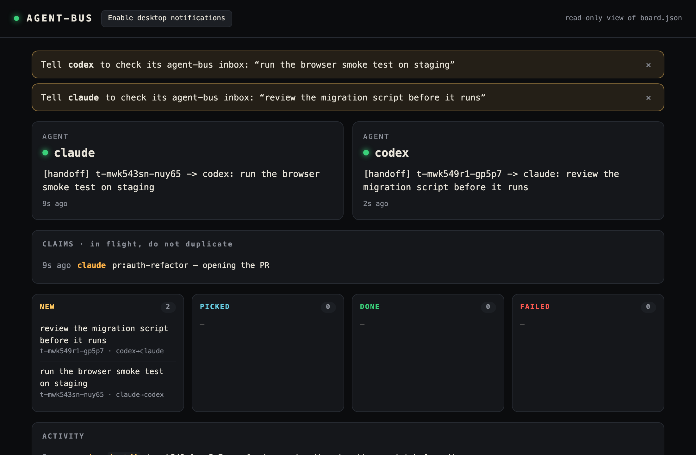

# agent-bus

[English](README.md)

给同一台电脑上的多个 AI 编程 agent 用的共享黑板。Claude Code、Codex 或任何 MCP 客户端接上之后可以:

- **认领(claim)**:动手前先给一件事上锁,两个 agent 不会各发一封同样的邮件、各开一个同样的 PR;
- **交接(handoff)**:把任务交给另一个 agent,并跟踪到完成或失败;
- **上板(post)**:写一句话状态,其他 agent 和你都看得到。

整个服务是一个零依赖的 Node 文件,状态是一个能直接打开看的 JSON 文件。



## 为什么做

给同一个人干活的两个 agent 看不到对方的会话,同一件事交代两边,两边都会做。这个项目的起因就是两个 agent 各自给同一封邮件拟了回复。解法很小:对外动作之前,先上一把对方看得见的锁。

## 安装

需要 Node 18 以上。

```bash
git clone https://github.com/SLYysl/agent-bus.git
cd agent-bus
node test.js          # 末尾应显示 ALL TESTS PASS
```

把每个 agent 都接到同一个 `server.js`,用绝对路径。

**Claude Code**

```bash
claude mcp add --scope user agent-bus -- node /绝对路径/agent-bus/server.js
```

**Codex**:在 `~/.codex/config.toml` 里加:

```toml
[mcp_servers.agent-bus]
command = "node"
args = ["/绝对路径/agent-bus/server.js"]
```

所有 agent 必须指向同一个黑板文件。默认是 `server.js` 旁边的 `board.json`,可用环境变量 `AGENT_BUS_FILE` 改位置。

然后把规则交给 agent:

- 把 [`AGENTS.md`](AGENTS.md) 贴进每个 agent 的指令文件,改成你自己的名字和分工;或者
- Claude Code 用户把 [`skills/agent-bus`](skills/agent-bus) 复制到 `~/.claude/skills/`。

## 试一下

对一个 agent 说:

> 用 agent-bus,以 claude 的名义认领 `demo:hello`。

对另一个说:

> 用 agent-bus,以 codex 的名义认领 `demo:hello`。

第二个会收到 `ALREADY CLAIMED … by claude`,然后停手。

## 工具

| 工具 | 作用 |
|---|---|
| `claim(topic, by, note?)` | 给一件事上锁。返回 `claimed`,或 `ALREADY CLAIMED` 和持有者。 |
| `release(topic, by, result?)` | 标记做完,附一句话结果。 |
| `handoff(to, task, by, note?)` | 给另一个 agent 建任务,返回任务 id。 |
| `inbox(agent)` | 列出交给该 agent 的未完成任务。 |
| `ack(taskId, by)` | 接活:`new` → `picked`。 |
| `complete(taskId, by, result?)` / `fail(taskId, by, reason?)` | 结束任务。 |
| `post(key, value, by)` / `get(key)` | 写、读一个状态值。 |
| `board()` | 全部内容:状态值、在途认领、未完成和最近结束的任务、最近活动。 |

agent 名字是自由文本,每次保持同一种写法。

## 看板和 watcher

```bash
node dashboard.js     # http://127.0.0.1:4317,只读
node watcher.js       # 演练模式:只打印它会叫醒谁
node watcher.js --go  # 真的对新任务执行 `codex exec …` / `claude -p …`
```

看板显示每个 agent 的最近动静、在途认领和任务泳道,并提示你该去提醒哪个 agent。watcher 默认不真跑,因为 `--go` 会启动 agent 并消耗 token。要改唤醒命令,编辑 `watcher.js` 里的 `TRIGGERS`。

## 边界

- **agent 不会自己醒。** MCP 是拉取式的。不开 watcher 的话,交接出去的任务要等你提醒接收方去查收件箱。
- **只管一台机器。** 黑板是本地文件,两台机器就是两块互不相通的黑板。
- **靠自觉。** 能写这个文件的进程都能写黑板,`by` 不做校验。它用来协调互相配合的 agent,不是权限控制。
- **认领 30 分钟过期**,崩掉的 agent 不会永久占着一件事。耗时更长的任务需要重新认领。
- **黑板上是 agent 写上去的内容。** 条目写短,别放密钥。`board.json` 因此默认不进 git。

## 锁是怎么做的

每个 agent 的 MCP 客户端各起一个 `server.js` 进程,所以是多个进程写同一个文件。每个会改动黑板的工具先拿排他锁文件(`board.json.lock`,用 `O_EXCL` 创建),再读、改、写临时文件、原子改名覆盖。`test.js` 起 12 个进程抢 25 个主题,检查每个主题恰好一个赢家;把锁去掉后,同一个测试会报出 200 多个赢家。

## 许可

Apache-2.0
